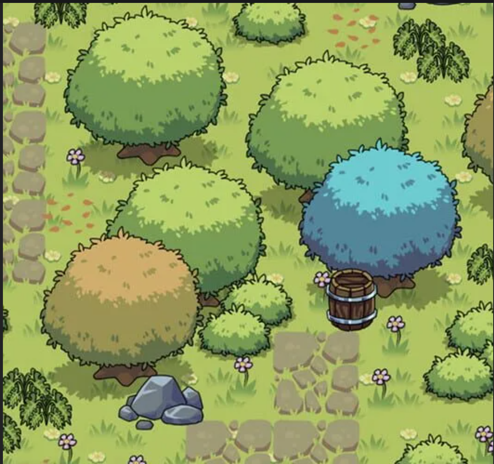

# Арт-направление — «Свод Правил»

- **Дата:** 2026-11-03.
- **Решения:** U-019, U-020; [ADR-0002](adr/ADR-0002-illustrated-world-art-direction.md).
**Статус документа:** подтверждённое направление и рабочие ориентиры; не готовый production art guide и не описание реализованной графики.

## 1. Что подтвердил владелец проекта

Исходная формулировка: «Примерно такую графику хочу в моей игре».

После уточнения владелец явно выбрал:

1. **Рисованный стиль вместо пиксель-арта** для окружения, предметов и героев.
2. **Сохранение акварельной карты и рисованных портретов.**
3. **Разную атмосферу по регионам:** светлые безопасные места и мрачные опасные зоны, объединённые общей техникой рисунка.

Это заменяет пиксельную часть прежнего U-007, но не отменяет смешанную подачу: игровой мир, карта и портреты остаются разными по назначению представлениями. Руны и древняя инфраструктура сохраняются как элементы идентичности мира.

## 2. Основной референс

[Открыть исходный PNG](references/art/ART-REF-0001.png) · [Происхождение и ограничения](references/art/README.md)

Референс показывает окружение, но не устанавливает дизайн героев, врагов, интерфейса или анимации. Это ориентир визуального языка, а не требование копировать композицию, деревья, бочку или конкретные объекты.

## 3. Что берём из примера

Ниже — разбор изображения, а не дополнительные прямые ответы владельца.

| Свойство | Наблюдение в референсе | Назначение для нашей игры |
|---|---|---|
| Силуэты | Округлые, крупные, хорошо различимые кроны и предметы | Быстрое чтение объектов на тактическом экране |
| Контур | Тёмный рисованный контур переменной выразительности | Отделение объекта от фона без фотореализма |
| Светотень | Несколько мягких ступеней света и тени, без гладкой реалистичной градации | Объём и цельность рисованного мира |
| Детали | Небольшие группы листьев, цветов, сколов и колец на предметах | Детализация пятнами, а не равномерный мелкий шум |
| Палитра | Зелёная основа, охристые и голубые акценты, тёмные тени | Возможность различать породы растений, объекты и состояния места |
| Ракурс | Взгляд сверху под углом, хорошо видны основания объектов | Основа для проверки читаемости маршрутов и боевого поля |
| Поверхность | Нет выраженной пиксельной сетки | Не имитировать pixel art и не добавлять пиксельный фильтр ради прежнего решения |

**Короткая формула:** рисованное приключенческое фэнтези, ясные силуэты, выразительный контур, мягкая ступенчатая светотень и единый визуальный язык при разной атмосфере регионов.

Точные толщины линий, количество тонов, разрешение исходников и способ анимации ещё не утверждены.

## 4. Единый стиль, разное настроение

Подтверждён принцип изменения атмосферы, а не обязательная одинаковая яркость всех локаций.

| Область | Рабочий ориентир | Статус |
|---|---|---|
| Безопасные поселения и маршруты | Больше света, зелени, тёплых деталей, ощущение обитаемого пути | PROPOSED |
| Опасные территории | Холодные или приглушённые сочетания, более тяжёлые тени, следы разрушения | PROPOSED |
| Древние узлы Сводов | Камень, бронза, руны и локализованные световые акценты поверх общей техники рисунка | PROPOSED |
| Карта мира | Акварельная/рисованная подача, отдельная от игровых локаций | CONFIRMED_BY_USER, сохранено при уточнении U-019 |
| Портреты героев | Более детальная рисованная подача, узнаваемость персонажей | CONFIRMED_BY_USER, сохранено при уточнении U-019 |

Примеры применения по регионам — **предложения для будущего арт-теста**, не финальные палитры:

- Зелёные пределы: свежая зелень, светлая трава, тёплое дерево.
- Чёрное болото: приглушённый оливковый, холодный бирюзовый, туман.
- Каменный хребет: сланцевые серые, охра, холодная высота.
- Пепельные земли: пепельный фон, ржаво-красные и янтарные акценты.
- Забытый тракт: мох, старый камень, бронза и рунический свет.
- Безмолвные равнины: бледные дальние планы и ограниченные цветовые ориентиры.
- Сердце Путей: тёмный камень и управляемые акценты древних механизмов.

Мрачность не должна уничтожать читаемость. Цвет региона меняет настроение, но не отменяет единые правила контура, формы и различения интерактивных объектов.

## 5. Ограничения, связанные с игрой

Это проектные требования к будущей визуализации; они не меняют SimulationCore:

- Герой, враг, предмет, проход и телеграф должны читаться при реальном масштабе камеры, а не только на крупном концепте.
- Декоративная трава и кроны не должны скрывать границы слотов, цели и опасные зоны.
- Интерактивный предмет должен отличаться от фонового не только цветом, но и формой/положением/подписью, когда это необходимо.
- Рунические эффекты и освещение не должны становиться фотореалистичными или заменять понятную форму объекта.
- Визуальные эффекты отображают события симуляции и не определяют урон, попадания или порядок AI.
- Сохраняется различие между портретом, боевой фигурой и объектом мира; увеличение детализации портрета не требует такой же плотности деталей на маленькой фигуре.

Конкретные способы выделения, масштаб и анимационные ограничения проверяются на прототипе.

## 6. Что пока открыто

| Вопрос | Статус |
|---|---|
| 2D-спрайты/слои или стилизованное 3D с контурным шейдингом | OPEN; референс не определяет технологию |
| Orthographic/perspective, точный угол камеры и масштаб | OPEN; прежний тактический вид сверху под углом остаётся проектным ориентиром |
| Пропорции и анатомия героев, стиль врагов и боссов | OPEN; подтверждена только общая рисованная стилистика |
| Толщина контура, число тонов, плотность деталей, текстура кисти | OPEN; требуется единый арт-тест |
| Финальные региональные палитры | PROPOSED / OPEN; подтверждён только принцип различия атмосферы |
| Финальный UI и интеграция рун в интерфейс | OPEN; структура редактора не равна утверждённому визуальному скину |
| Источник и права на предоставленное изображение | OPEN; коммерческое использование самого изображения не подтверждено |

## 7. Следующая проверка стиля — предложение

До массового производства графики подготовить небольшой оригинальный арт-тест:

1. Один участок пути: трава, дерево, камень, небольшой интерактивный предмет и фрагмент рунического механизма.
2. Одна боевая фигура героя и один враг в той же технике; без производства полного ростера.
3. Два освещения одного набора: безопасный светлый участок и опасная приглушённая зона.
4. Проверка при игровом масштабе камеры: силуэты, основания объектов, цели, проходы и телеграфы.
5. Отдельно проверить согласованность с акварельной картой и рисованным портретом.

Это предлагаемый объём проверки, не обещание готовых UE assets. Для реализации нужен выбранный технический подход и подходящая среда.

**Критерий успеха:** владелец узнаёт выбранный стиль, объекты читаются в игре, а светлая и мрачная зоны выглядят частями одного мира. Результат фиксируется с версией арт-гайда; до проверки численные параметры не объявляются каноном.

## 8. Происхождение и использование референса

Изображение предоставлено владельцем проекта. Автор, исходная игра/публикация и лицензия не установлены. Файл сохранён без изменений как внутренний референс; это не подтверждение права включать его в коммерческую игру, рекламные материалы или распространять как готовый asset.

Новые игровые изображения и объекты должны иметь собственную фиксацию происхождения и прав. Не выдавать референс за созданный нами арт или за уже реализованный экран игры.
